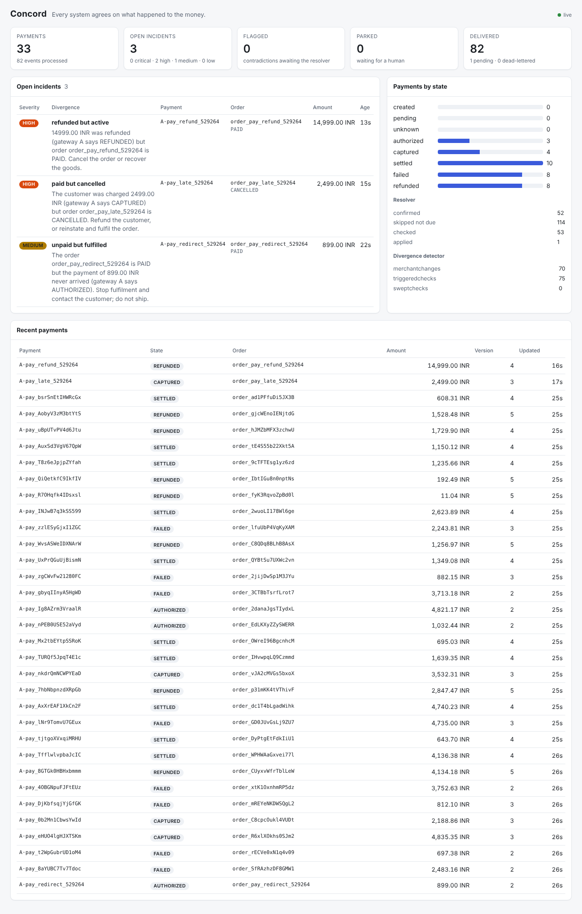
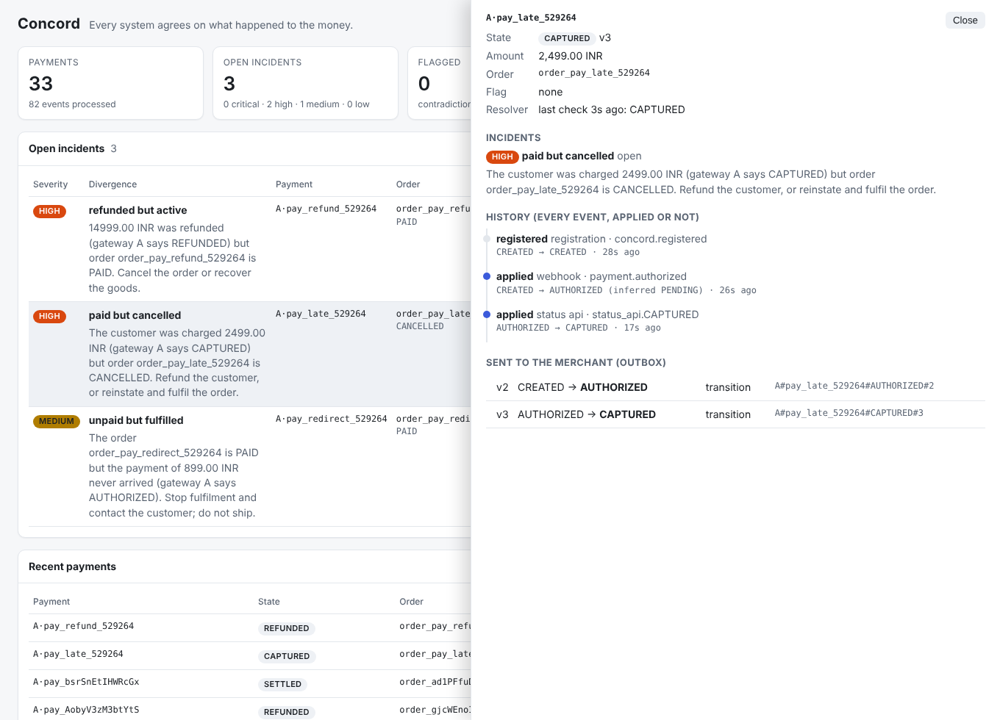

# Phase 4 — Divergence detector and dashboard

## Problem

Phases 0–3 make Concord's own state correct and deliver it exactly once. But the merchant can still
drift on its own: its checkout timeout cancels an order whose payment is only late; it trusts a
browser redirect and ships an order that was never paid; it misses an event and keeps a refunded order
active. **Neither the gateway's dashboard nor the merchant's database shows an error on its own**:
each looks fine alone. The mismatch only appears when the two are compared.

```
gateway status API  ──┐
Concord state        ──┼──> divergence detector ──> classify ──> incident + severity (amount x age x type)
merchant order        ─┘      ^          ^    ^                        │
  (adapter, not its DB)       │          │    └ periodic sweep          ├──> dashboard
                    outbox change   merchant change feed                └──> CONCORD_DRIFT: flag for the resolver
```

## What was built

| Piece | Where |
|---|---|
| `Classifier` (pure), `Severity`, `Incident`, `DivergenceDetector` | `divergence/` |
| Incident + detector state stores (memory, DynamoDB: same table, sparse GSI2 `INCIDENT`) | `divergence/` |
| Merchant adapter: `getOrder`, keyset-paginated `changedSince` | `resolver/merchant` |
| Merchant drift sources: checkout timeout job, redirect bug, event-loss fault; `/orders/changed` | `sample-merchant/` |
| Dashboard (React 18 + htm, vendored, no build step) and `/api/*` | `local-runner/` |
| `DetectorLambda` on EventBridge Scheduler (every 2 min) | `infra/terraform/divergence.tf` |
| `scripts/phase4_demo.py`: inject the three bugs next to clean payments | `scripts/` |

## Classification

Truth is the gateway's status API (Concord's state if the gateway does not answer):

| Money really… | Merchant order says | Divergence | Weight | Suggested action |
|---|---|---|---|---|
| captured / settled | CANCELLED, PAYMENT_FAILED | **PAID_BUT_CANCELLED** | 3 | refund, or reinstate and fulfil |
| captured / settled | AWAITING_PAYMENT | PAID_BUT_AWAITING | 1 | mark paid; find out why the event was missed |
| refunded | PAID | **REFUNDED_BUT_ACTIVE** | 2 | cancel the order or recover the goods |
| not captured | PAID | **UNPAID_BUT_FULFILLED** | 3 | stop fulfilment; do not ship |
| captured amount A | order amount B | AMOUNT_MISMATCH | 2 | check the order total |
| gateway X | Concord Y | CONCORD_DRIFT | 1 | flag the payment: the resolver fixes it |

`UNKNOWN` at Concord against `PENDING` at the gateway is not a drift (UNKNOWN means "still pending,
gateway slow to answer").

## Design decisions

### 1. Batch or streaming? Both

- **Event-triggered** checks catch most divergences quickly: every outbox change (Concord learned
  something) schedules a check after a settle delay; every **merchant-side** change does too, read from
  the merchant's change feed.
- Event-only checks miss **the case where nothing happens**: the webhook that never came, the payment
  nobody touched. A nightly batch is far too slow. So a **periodic sweep** reads payments changed within
  a window, page by page from the state + updated_at index (`queryPaginator`, LastEvaluatedKey), and
  skips any payment checked within `recheckInterval`.

### 2. A grace period, so in-flight is not "wrong"

Right after Concord learns "captured", the merchant still says "awaiting payment" for a moment: the
delivery is in flight. Reporting that would bury real problems in noise. A divergence becomes an
incident only if it is **still there `grace` after it was first seen**; the detector schedules its own
re-check for exactly that moment. Tested: an in-flight delivery never raises an incident, and 60 clean
payments raise none.

### 3. Severity = amount × age × type

`score = amountMinor × weight × (1 + age in minutes / 60)`: it doubles after an hour. Tiers: LOW,
MEDIUM (≥ 50,000), HIGH (≥ 500,000), CRITICAL (≥ 5,000,000 minor units). Severity is recomputed on
every check, so an old incident rises in the list. The age starts when the divergence was first seen.

### 4. Incidents have a lifecycle

One OPEN incident per (payment, type), updated in place; **resolved automatically** when a later
check no longer sees the divergence (with what changed); a new occurrence after that counts up. In
DynamoDB, open incidents sit in the sparse GSI2 under `INCIDENT`, sort key `<tier>#<score>`, so the
dashboard's "worst first" list is one backwards Query. GSI2 is now the general "needs attention" index:
`VERIFY` (flagged), `PARKED` (resolver gave up), `INCIDENT` (open divergences).

### 5. Decoupled from the merchant's data

Concord never reads the merchant's database. The merchant implements a small adapter: get an order,
and list orders changed since a cursor. The sample merchant implements it over HTTP + PostgreSQL; a
real merchant implements it against its own system.

### 6. A change feed that does not lose changes

`GET /orders/changed?since=&after=&limit=` uses **keyset pagination** on `(updated_at, order_id)`:
- unlike `OFFSET`, it never skips or repeats rows while orders keep changing;
- each page is one index range scan (`EXPLAIN`, 20,000 orders, run in a test):

```
Limit  (cost=0.29..56.34 rows=200 width=117)
  ->  Index Scan using orders_by_change on orders  (cost=0.29..1868.80 rows=6667 width=117)
        Index Cond: (ROW(updated_at, order_id) > ROW('2026-01-01 00:00:00+00'::timestamptz, ''::text))
```

- the cursor keeps microseconds as text (PostgreSQL's precision; a JSON date would truncate to
  milliseconds and repeat or skip rows at page boundaries);
- **rows younger than a 2 s safety lag are not returned yet.** A transaction can stamp `updated_at`
  and commit later, after a reader already moved its cursor past that time; without the lag that change
  would be missed forever. `clock_timestamp()` (not `now()`, which is the transaction's start) narrows
  the gap further. The detector saves its cursor, so a restart continues where it stopped.

### 7. The detector feeds the resolver

A CONCORD_DRIFT (e.g. a refund at the gateway whose webhook was lost after Concord had already
verified "captured") flags the payment. The resolver picks flagged payments up from the sparse index
and applies the truth. Phase 3 verifies each final state once; Phase 4's sweep keeps re-comparing
within its window, so later changes at the gateway are caught too.

## Done when — met

> An injected "missed webhook, order timed out" scenario is flagged with the correct classification
> within minutes.

`DivergenceDetectionTest` (everything real: HTTP, DynamoDB + Streams, PostgreSQL):

- `pay_late`: authorized; capture at 5 s with its webhook dropped; the merchant's checkout timeout
  (3 s) cancels the order; Concord recovers the capture from the status API and delivers it; the order
  stays cancelled → **PAID_BUT_CANCELLED, raised 1–3 s after the capture really happened** (4 runs:
  1.1, 2.3, 2.8, 3.0 s; real-world timings: grace 2 min, sweep every 2 min → within minutes);
- `pay_redirect`: the shop marks an authorized-only order paid → UNPAID_BUT_FULFILLED, which then
  **resolves itself** when the resolver captures the payment (the merchant's order is valid);
- `pay_refund`: the merchant loses this order's events after the capture; the refund arrives →
  REFUNDED_BUT_ACTIVE;
- **60 clean payments: no incident, open or resolved.**

The same three, injected into the running system with `scripts/phase4_demo.py`:

```
t+  9.1s  MEDIUM   UNPAID_BUT_FULFILLED   pay_redirect_529264: order PAID, gateway AUTHORIZED
t+ 16.6s  HIGH     PAID_BUT_CANCELLED     pay_late_529264: order CANCELLED, gateway CAPTURED
t+ 18.6s  HIGH     REFUNDED_BUT_ACTIVE    pay_refund_529264: order PAID, gateway REFUNDED
missing: none | incidents on clean payments: none
```

## Dashboard



Open incidents worst first with a plain-language explanation and suggested action; payments by state;
resolver and detector counters; recent payments. Clicking a payment shows its whole story: every event
(applied, stale, contradiction, …) with its source and inferred states, what was sent to the merchant,
its incidents and the resolver's last check.



React 18 with `htm` (JSX-like templates at runtime) and the files vendored: no build step, no CDN, no
Node in CI or Docker. Checked with Playwright in light and dark mode and at phone width (no horizontal
overflow, no console errors). For a bigger UI, moving to Vite + TypeScript is the obvious next step.

## Known gaps

- Explanations are templates; the AI layer (Phase 5) will write them from the payment's history.
- Orders the merchant has but Concord never saw (an unregistered payment) are not checked.
- In AWS the detector runs every 2 minutes; outbox-triggered checks need a second stream consumer.
- Merchant statuses are the sample merchant's; a real adapter maps its own statuses onto them.

## Interview talking points

- Why each system "looks fine alone", and why the comparison must include the merchant.
- Event-triggered + windowed sweep; why neither alone is enough.
- Grace period: precision (no false positives) vs latency.
- Severity as amount × age × type, recomputed so old incidents rise.
- Keyset pagination vs OFFSET; `EXPLAIN`; the commit-order race in timestamp change feeds and the
  safety lag; `now()` vs `clock_timestamp()`.
- Adapter pattern: Concord never touches the merchant's database.
- Sparse GSI as an "attention" index serving three different queues.
